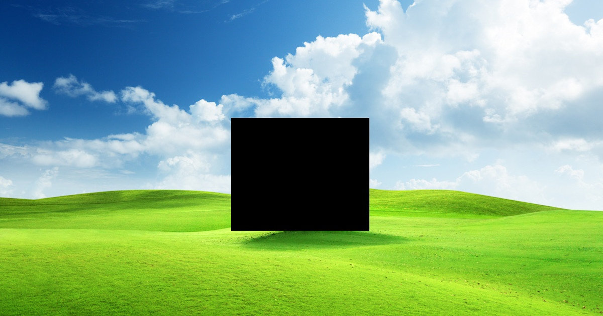
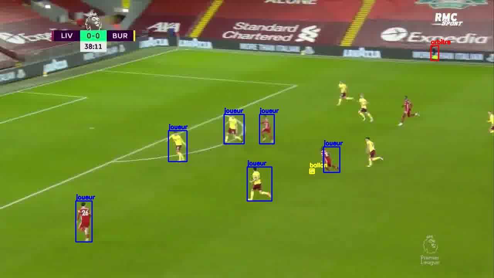
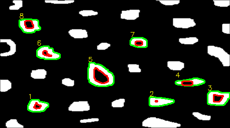
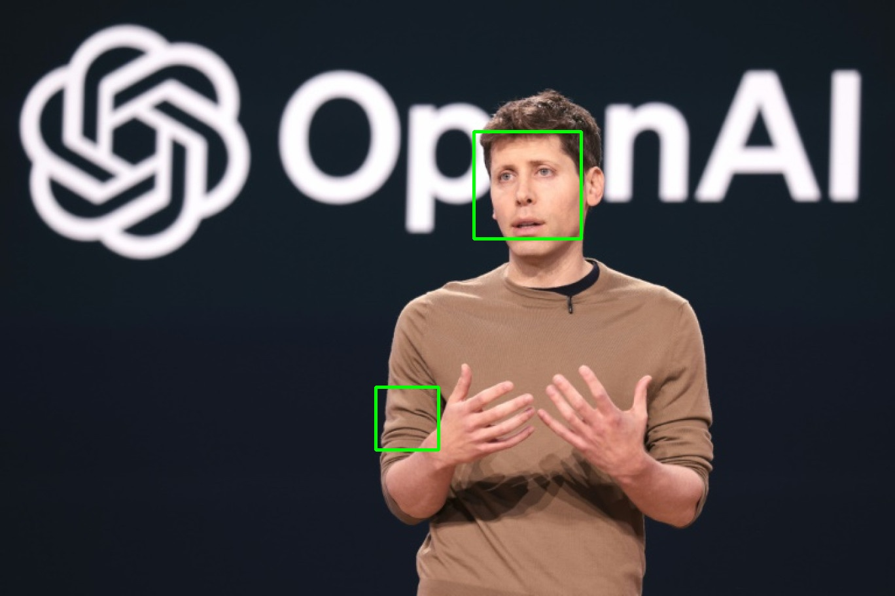
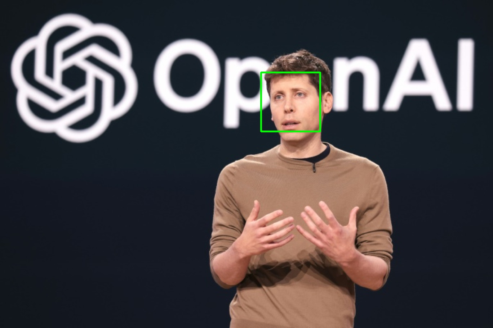
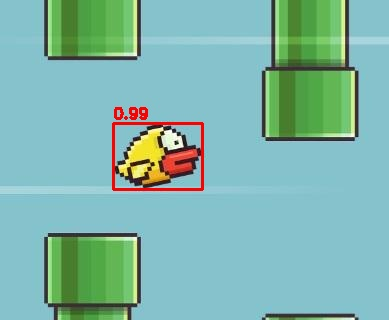
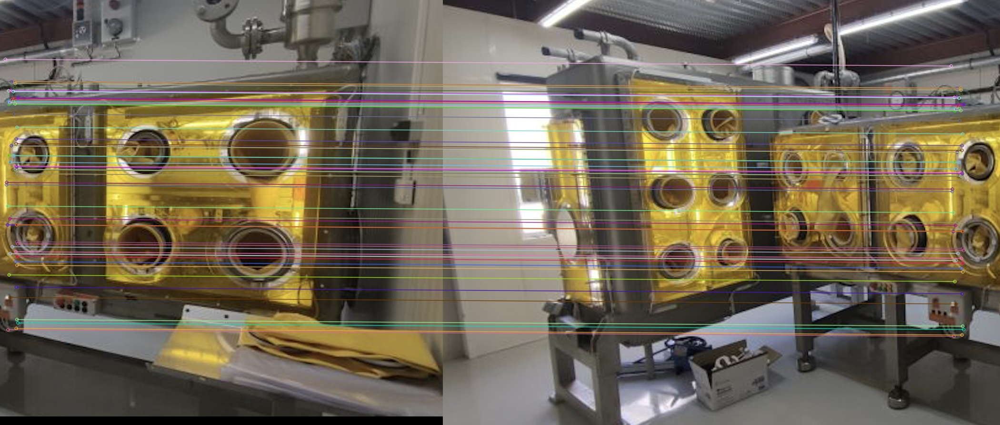
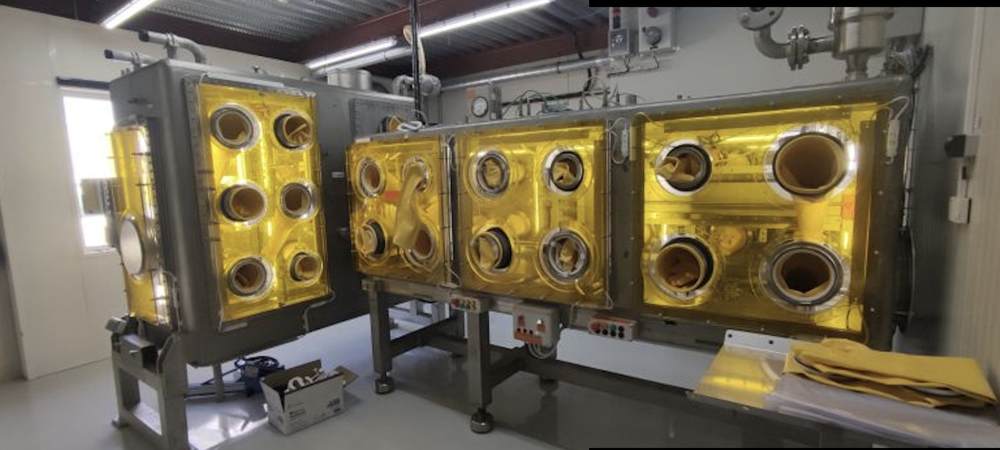

# TD OpenCV : corrigé et documentation

Ce dossier contient le TD OpenCV (6 exercices) résolu dans **`TD_OpenCV.ipynb`**.
Les consignes d'origine sont conservées ; chaque consigne est suivie du code qui la résout, exécuté (les sorties sont visibles directement dans le notebook).
Toutes les images produites sont enregistrées dans **`resultats/`**.

| Exercice | Sujet | Résultat |
|---|---|---|
| 1 | Mettre une zone de l'image en noir | zone 275 × 225 px noircie (l'arbre), sélection à la souris possible |
| 2 | Vérifier des annotations (Makesense, format YOLO) | 5 images, 29 boîtes (5 ballons, 22 joueurs, 2 arbitres), toutes valides |
| 3 | Compter les bulles avec `findContours` | **8 bulles** sur 40 contours |
| 4 | Détection de visages (Haar) + webcam | 1 visage ; 1 faux positif éliminé par la vérification des yeux |
| 5 | Template matching | oiseau trouvé en (113, 123), score 0,991 ; les 6 méthodes sont d'accord |
| 6 | Image stitching | translation (1056, 14) px, 342/357 matchs cohérents, panorama 1986 × 894 |

---

## Lancer le TD

```bash
cd TD
python -m venv .venv
.venv\Scripts\activate            # Windows (Linux/Mac : source .venv/bin/activate)
pip install -r requirements.txt
jupyter notebook TD_OpenCV.ipynb   # puis "Run All"
```

Le notebook s'exécute **depuis le dossier `TD/`** (chemins relatifs du type `Exercice 3/bubble.png`).
Il fonctionne aussi sur Colab (OpenCV 4.x y est préinstallé), à condition d'y déposer les dossiers `Exercice k/` ; seules la sélection de zone à la souris (ex. 1) et la webcam (ex. 4.2) demandent une exécution locale.

### Problème rencontré : OpenCV 5 n'a plus `CascadeClassifier`

Le projet Sudoku utilise **OpenCV 5.0**. Dans cette version, `cv2.CascadeClassifier` et les fichiers `haarcascade_*.xml` ont été **retirés du paquet principal** (`AttributeError: module 'cv2' has no attribute 'CascadeClassifier'`, et `cv2.data.haarcascades` est vide).
L'exercice 4 demande explicitement cette fonction : le TD utilise donc un **environnement séparé avec OpenCV 4.x** (`opencv-python>=4.8,<5`, testé avec 4.14.0), pour ne pas casser l'environnement du projet Sudoku.

---

## Exercice 1 : transformer une zone de pixels

**Principe.** Une image OpenCV est un tableau numpy `img[ligne, colonne, canal]`. Mettre une zone en noir revient à affecter 0 à une tranche du tableau : `img[y:y+h, x:x+w] = 0`.

**Code.** `noircir_zone(img, x, y, w, h)` :
- travaille sur une **copie** (l'image d'origine reste intacte) ;
- **rogne** le rectangle aux bords de l'image, donc une zone qui déborde ne provoque pas d'erreur.

**Choix de la zone.** Deux modes :
- `INTERACTIF = True` : `cv2.selectROI` ouvre une fenêtre, on trace le rectangle à la souris et on valide avec Entrée ;
- `INTERACTIF = False` (par défaut, pour que le notebook tourne de bout en bout) : zone fixe sur l'arbre, `(x=460, y=235, w=275, h=225)`.



---

## Exercice 2 : vérifier des annotations

**Annotation.** Les 5 images `foot_k.jpg` ont été annotées avec 3 classes (`ballon`, `joueur`, `arbitre`) et exportées au **format YOLO de Makesense.ai** (`Actions > Export Annotations > YOLO`). Les fichiers sont dans `Exercice 2/annotations/` :
- `labels.txt` : une classe par ligne, l'indice de la ligne est l'identifiant de classe ;
- `foot_k.txt` : une ligne par objet, `classe x_centre y_centre largeur hauteur`, normalisés entre 0 et 1.

> Les boîtes ont été relevées à la main en pixels puis converties au format d'export de Makesense (même structure de fichiers), sans passer par l'interface web. Pour refaire l'annotation sur makesense.ai, il suffit d'y charger les 5 images et `labels.txt`, puis d'exporter en YOLO dans le même dossier : le code de vérification reste identique.

Choix d'annotation :
- les **gardiens** sont des `joueur` ;
- il n'y a **pas d'arbitre central** visible sur ces images ; l'`arbitre` annoté est l'**arbitre assistant** (tenue fluo, le long de la ligne de touche en haut à droite) sur foot_1 et foot_2 ;
- au moins 3 objets par image (5 à 8), dont le ballon sur chaque image. Sur foot_5, le ballon est flou (en mouvement) et très petit, autour de (821, 353) : c'est l'annotation la moins sûre.

**Vérification (le cœur de l'exercice).** On reconstruit les boîtes en pixels à partir du format normalisé :

```
x1 = (xc - w/2) * W     y1 = (yc - h/2) * H
x2 = (xc + w/2) * W     y2 = (yc + h/2) * H
```

puis on les dessine avec `cv2.rectangle` et `cv2.putText` (une couleur par classe). Le code fait aussi des **contrôles automatiques** : au moins 3 objets par image, et chaque boîte non vide et entièrement dans l'image (`0 ≤ x1 < x2 ≤ W`, `0 ≤ y1 < y2 ≤ H`).

| Image | Objets | ballon | joueur | arbitre |
|---|---|---|---|---|
| foot_1 | 8 | 1 | 6 | 1 |
| foot_2 | 6 | 1 | 4 | 1 |
| foot_3 | 5 | 1 | 4 | 0 |
| foot_4 | 5 | 1 | 4 | 0 |
| foot_5 | 5 | 1 | 4 | 0 |

L'inspection visuelle des images redessinées confirme que chaque boîte entoure bien son objet.



**Pièges évités :** confondre centre et coin (YOLO donne le **centre**), oublier la dénormalisation, inverser largeur/hauteur de l'image (`img.shape` renvoie `(H, W, canaux)`).

---

## Exercice 3 : compter les bulles avec les contours

**Définition de l'énoncé :** une bulle est un contour qui **contient un autre contour**.

**Méthode.**
1. Binarisation (`cv2.threshold` à 127) : l'image ne contient que 0 et 255, formes blanches sur fond noir.
2. `cv2.findContours(..., cv2.RETR_TREE, ...)` : `RETR_TREE` renvoie **toute la hiérarchie** des contours. Pour chaque contour `i`, `hierarchie[i] = [suivant, précédent, premier_enfant, parent]`.
3. Une bulle est un contour qui a un enfant : `hierarchie[i][2] != -1`.

Avec `RETR_EXTERNAL` on n'aurait que les contours extérieurs et on ne pourrait pas distinguer formes pleines et bulles : c'est pour cela qu'il faut `RETR_TREE` (ou `RETR_CCOMP`).

**Résultat : 40 contours, dont 8 bulles** (contour extérieur en vert, trou en rouge).



**Remarques.**
- La forme en « C » sur le bord gauche (vers y = 95) **n'est pas comptée** : son trou n'est pas fermé (la forme est coupée par le bord de l'image), donc il n'y a pas de contour intérieur. C'est cohérent avec la définition.
- La bulle n° 2 a un trou minuscule (aire 6 px²) mais c'est bien un trou fermé, elle compte.

---

## Exercice 4 : détection de visages

### 4.1 Détecteur avec `cv2.CascadeClassifier`

**Principe (Viola & Jones).** Le classifieur pré-entraîné `haarcascade_frontalface_default.xml` fait glisser une fenêtre sur l'image à plusieurs échelles. Chaque fenêtre passe par une **cascade** d'étages de features de Haar (différences de sommes de rectangles clairs/sombres, calculées vite grâce à l'image intégrale) ; une fenêtre est rejetée dès qu'un étage échoue, ce qui rend la méthode rapide.

**Code.** `detecter_visages(img, scaleFactor, minNeighbors, minSize, verifier_yeux)` :
- passage en niveaux de gris + `equalizeHist` (moins sensible à l'éclairage) ;
- `detectMultiScale` : `scaleFactor=1.1` (pas de 10 % entre deux échelles), `minNeighbors=5` (nombre de détections qui se chevauchent nécessaires pour garder un visage), `minSize=(40, 40)`.

**Problème rencontré : faux positif.** Avec les réglages classiques, la cascade trouve **2 « visages »** : le vrai (164 × 164 px) et un **faux positif sur la manche** (96 × 96 px). Étude de `minNeighbors` :

| minNeighbors | 0 | 1 | 3 | 5 | 8 | 10 |
|---|---|---|---|---|---|---|
| détections | 92 | 4 | 2 | 2 | 2 | 1 |

Monter `minNeighbors` à 10 supprime le faux positif, mais c'est un réglage **propre à cette image** (on risque de rater de vrais visages ailleurs). Solution retenue, plus générale : **vérification par les yeux**. Une deuxième cascade (`haarcascade_eye.xml`) cherche des yeux dans les 2/3 hauts de chaque visage détecté, et on ne garde que les visages où au moins un œil est trouvé. Le vrai visage a 2 yeux détectés, la manche 0, donc **1 visage final**.

| Cascade seule | Cascade + yeux |
|---|---|
|  |  |

### 4.2 Webcam

Même fonction appliquée image par image sur le flux `cv2.VideoCapture(0)`, avec effet miroir, compteur de visages et FPS ; `q` ou Échap pour quitter.
- dans le notebook : fonction `webcam_visages()`, désactivée par défaut (`LANCER_WEBCAM = False`) pour que « Run All » marche sans webcam ;
- en script (plus pratique, car `cv2.imshow` dans Jupyter peut bloquer) :

```bash
python "Exercice 4/webcam_visages.py"          # options : --camera 1, --min-neighbors 8, --yeux
```

Test fait : 15 images 640 × 480 lues sur la webcam du PC avec détection à environ 10 images/s (démarrage de la caméra compris), sans affichage ni enregistrement.
Limite : `cv2.imshow` n'existe pas sur Colab (il faudrait capturer la webcam en JavaScript), d'où l'exécution locale.

---

## Exercice 5 : template matching

**Principe.** `cv2.matchTemplate` fait glisser le template (89 × 66 px) sur toute l'image (389 × 320) et calcule un score à chaque position, ce qui donne une **carte de score** de taille `(H - h + 1, W - w + 1)`. `cv2.minMaxLoc` donne la meilleure position (coin haut-gauche du match).

**Méthode principale : `TM_CCOEFF_NORMED`** (corrélation normalisée, entre -1 et 1, insensible à un changement global de luminosité) : le meilleur match est le **maximum**. Pour `TM_SQDIFF(_NORMED)` (une distance), c'est le **minimum** : piège classique.

**Résultat :** oiseau trouvé en **(113, 123)** avec un score de **0,991**. Les 6 méthodes donnent exactement la même position :

| Méthode | Position |
|---|---|
| TM_SQDIFF / TM_SQDIFF_NORMED (min) | (113, 123) |
| TM_CCORR / TM_CCORR_NORMED (max) | (113, 123) |
| TM_CCOEFF / TM_CCOEFF_NORMED (max) | (113, 123) |



Limite : le template matching n'est **pas invariant à l'échelle ni à la rotation**. Ici le template est découpé dans la même image, donc ça marche parfaitement ; pour un oiseau de taille différente il faudrait tester plusieurs échelles (pyramide) ou passer à des features (exercice 6).

---

## Exercice 6 : image stitching

**Étape 1 : features.** Détecteur et descripteur **SIFT** (`cv2.SIFT_create`), invariant à l'échelle et à la rotation : **2799 points** sur gauche, **1758** sur droite.

**Étape 2 : matchs.** `BFMatcher` (distance L2), `knnMatch` avec k = 2, puis **test du ratio de Lowe** : on garde un match seulement si sa distance est < 0,75 × celle du 2e voisin (élimine les points ambigus, par ex. les motifs répétés des hublots). **1758 matchs bruts → 357 conservés.**



**Étape 3 : translation.** Pour chaque match, `point_gauche - point_droite` est le décalage `(dx, dy)` à appliquer à l'image de droite pour la placer dans le repère de gauche. On prend la **médiane** (robuste aux faux matchs restants, contrairement à la moyenne) : **(dx, dy) = (1056, 14)**. 342 des 357 matchs (96 %) sont à moins de 10 px de cette translation.

*Vérification :* au départ, l'image de droite **semble prise de plus près** (les hublots paraissent plus grands), donc on pouvait craindre qu'une translation ne suffise pas. Pour le vérifier, on estime une **similitude** (rotation + échelle + translation) par RANSAC avec `cv2.estimateAffinePartial2D` : **échelle 0,9999, angle 0,004°, translation (1056,0 ; 14,0)**. Il s'agit donc bien d'une **translation pure** : les hublots de droite sont simplement des hublots différents, plus gros, de l'autre boîte à gants. La translation demandée par l'énoncé est le bon modèle.

**Étape 4 : recollage.** Toile de `max(largeurs décalées) × max(hauteurs décalées)`, on pose gauche, puis droite décalée de (1056, 14) ; les décalages négatifs sont gérés par un offset. Dans la **bande de recouvrement (114 px)**, on fait un **fondu linéaire** (alpha de 0 à 1 de gauche à droite), ce qui supprime la couture visible. Panorama : **1986 × 894 px**. Les bandes noires en haut à droite et en bas à gauche viennent de la différence de hauteur et du décalage vertical de 14 px.



Pour aller plus loin : avec un vrai changement de point de vue, il faudrait une **homographie** (`cv2.findHomography` + RANSAC, puis `cv2.warpPerspective`) au lieu d'une simple translation.

---

## Contenu du dossier

```
TD/
├── TD_OpenCV.ipynb              # notebook résolu et exécuté
├── README.md                    # cette documentation
├── requirements.txt             # environnement du TD (OpenCV 4.x)
├── Exercice 1/sample.jpg
├── Exercice 2/foot_1..5.jpg
│   └── annotations/             # export YOLO (labels.txt + foot_k.txt)
├── Exercice 3/bubble.png
├── Exercice 4/sam_altman.jpg
│   └── webcam_visages.py        # détection de visages en direct
├── Exercice 5/ref_image.jpg, template.jpg
├── Exercice 6/gauche.png, droite.png
└── resultats/                   # images produites par le notebook
```
