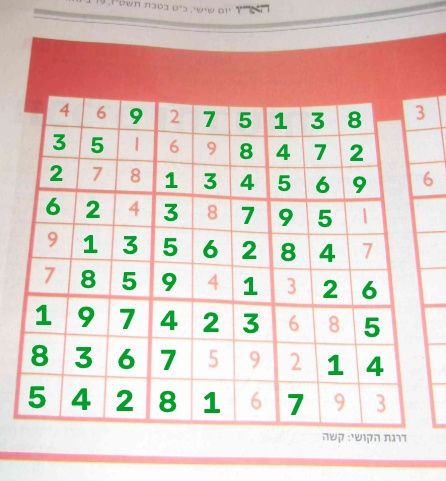

# 3. Trouver, redresser et découper la grille

Code : `src/sudoku_cv/warp.py`, `src/sudoku_cv/cells.py`, `scripts/extract_cells.py`.
Tests : `tests/test_warp.py`.

Le but est de passer d'une photo prise de travers à une image carrée de 450×450 où la grille est
assez bien alignée pour être coupée en 9×9 cases régulières.

## Trouver les 4 coins (`find_grid_corners`)

1. Passage en niveaux de gris et réduction à 1000 px max. Les photos font 12 Mpx, et la pleine
   résolution ralentit sans aider à trouver un contour.
2. Flou gaussien 7×7, pour enlever le grain du papier et le bruit du capteur.
3. Seuillage adaptatif : chaque pixel est comparé à la moyenne de son voisinage. Un seuil global
   échouerait, car l'éclairage varie sur la photo.
4. Dilatation 3×3, pour refermer les petites coupures dans les traits.
5. Contours externes triés par aire décroissante. On garde le premier qui, simplifié par
   `approxPolyDP`, est un quadrilatère convexe d'au moins 10 % de l'image.
6. Les 4 points reviennent à l'échelle d'origine et sont ordonnés : le plus petit `x+y` est en
   haut à gauche, le plus grand en bas à droite, et `y−x` départage les deux autres.

La fonction accepte aussi le cadre du détecteur YOLO. La recherche se limite alors à cette zone
(+5 % de marge), et si aucun quadrilatère n'y est trouvé, on prend les coins du cadre. YOLO trouve
la grille dans une scène chargée, OpenCV place ensuite le coin au pixel près.

## Redressement simple par 4 points (`warp_grid`)

`getPerspectiveTransform` calcule l'homographie qui envoie les 4 coins sur un carré 450×450 (9
cases de 50 px) et `warpPerspective` l'applique. La matrice inverse sert à reprojeter la solution
sur la photo.

Ça ne suffit pas sur un livre ouvert. Une homographie suppose une grille plane : sur une page
courbée, les traits restent courbes après redressement, et des morceaux de traits tombent dans les
cases. Nombre de cases détectées comme remplies, comparé à un comptage à la main :

| Photo | Redressement 4 points | Vérité |
|---|---|---|
| 4 | 35 | 28 |
| 19 | 35 | 28 |
| 17 | 47 | ? (beaucoup moins) |

## Redressement fin (`dewarp_grid`)

On ne se fie plus à 4 points : on retrouve les 20 traits de la grille (10 horizontaux, 10
verticaux) et leurs 100 intersections, puis on redresse case par case.

1. Redressement grossier par 4 points avec 10 % de marge autour du carré. Sans marge, un coin mal
   placé coupe un bout de grille qu'on ne retrouvera plus.
2. Seuillage adaptatif, puis ouverture morphologique avec un élément long et fin (horizontal pour
   un masque, vertical pour l'autre). Seuls les segments plus longs que 60 % d'une case survivent :
   les traits restent, les chiffres disparaissent.
3. Pour chaque trait k, on parcourt l'image tous les 4 px et on cherche la réponse maximale dans une
   fenêtre de ±40 % de case autour de la position théorique.
4. On ajuste une parabole (degré 2) sur ces points, on rejette les points à plus de 4 px d'écart, et
   on ajuste une seconde fois. Une parabole suffit pour une page qui se courbe régulièrement.
5. Les intersections se calculent par itération de point fixe (`y = h(x)`, `x = v(y)`, 5 itérations).
6. `cv2.remap` place chaque pixel de sortie par interpolation bilinéaire entre les 4 intersections
   de sa case.

Les 100 intersections sont aussi renvoyées en coordonnées de la photo : c'est grâce à elles que la
solution s'écrit au bon endroit, même sur une page courbée.

| Photo | 4 points | Redressement fin | Vérité |
|---|---|---|---|
| 19 | 35 | 28 | 28 |
| 16 | 34 | 27 | — |
| 4 | 35 | 32 | 28 |
| 8 | 28 | 29 | 28 |
| 17 | 47 | 34 | — |

25 grilles trouvées sur 25. Deux problèmes restent. Sur la photo 17, la courbure est forte et le
coin bas-gauche est mal trouvé par le contour, donc le bas de la grille reste déformé ; on a écarté
cette photo plutôt que de la traiter (pistes non testées : suivre les traits de proche en proche,
polynôme de degré 3). Sur les photos 4 et 8, des restes de traits sur les bords font compter
quelques cases vides comme remplies.

## Découper les cases (`split_cells`, `preprocess_cell`)

La grille 450×450 est coupée en 9×9, et on rogne 12 % de chaque côté de la case pour enlever les
traits. `preprocess_cell` redimensionne en 64×64 et garde le canal le plus sombre (min de B, G, R)
au lieu du niveau de gris habituel. En niveaux de gris, une encre rouge donne un gris moyen (~110
sur un fond à ~200), peu contrasté ; dans le canal le plus sombre elle vaut ~70, aussi contrastée
qu'une encre noire.

## Détecter une case remplie (`cell_has_ink`)

Cette règle sert seulement au pré-tri des cases, pas à la lecture finale : une case est remplie si
au moins 3 % de sa zone centrale est plus sombre d'au moins 30 niveaux que son fond (médiane).

La première version (pixel < 0,6 × fond, en niveaux de gris) trouvait 0 case remplie sur les photos
23-25, à chiffres rouges. D'où le passage au canal le plus sombre avec un écart absolu. Le seuil a
été choisi en comparant 30, 40, 50 et 60 sur les 25 photos :

| Photo | 30 | 40 | 50 | 60 | Vérité |
|---|---|---|---|---|---|
| 1 (verso visible) | 27 | 27 | 27 | 27 | 27 |
| 23 (rouge) | 27 | 25 | 5 | 1 | 27 |
| 25 (rouge) | 26 | 19 | 2 | 0 | 26 |

Les chiffres fantômes du verso sont ~25 niveaux plus sombres que le fond, les chiffres rouges flous
~60, les chiffres noirs ~180 : 30 sépare bien ces cas.

## Vérifier les coins avec les traits (`refine_corners`)

Ajouté après un échec sur une de nos photos (grille rose sur bandeau rouge, grille voisine collée ;
tout est dans le [journal](journal.md)). Le contour extérieur peut englober autre chose que la
grille. On redresse donc grossièrement avec une marge et on retrouve les 10 traits de chaque
direction. S'ils tombent là où le contour place les bords, on garde le contour, plus précis. Sinon,
les coins deviennent les intersections des traits extrêmes.

Pour choisir les 10 traits parmi les pics (bord de page, bandeau, grille voisine, barres de 1 ou de
7), on combine la régularité de l'espacement (courbe de degré 2, pour tolérer la perspective), une
pénalité par pic sauté, et un bonus si les traits 0, 3, 6, 9 (bords des blocs) sont plus épais.

## Tests et debug

Les tests utilisent une photo synthétique : une grille dessinée, quelques chiffres, puis une
déformation en perspective sur fond gris. On vérifie l'ordre des coins, des coins retrouvés à moins
de 8 px (avec et sans cadre), le repli sur le cadre, le redressement et le découpage avec les bonnes
cases remplies, et les 100 intersections.

`scripts/extract_cells.py` écrit pour chaque photo le contour (rouge) et les intersections (vert)
dans `data/debug/corners/`, et la grille redressée dans `data/debug/warped/`.
