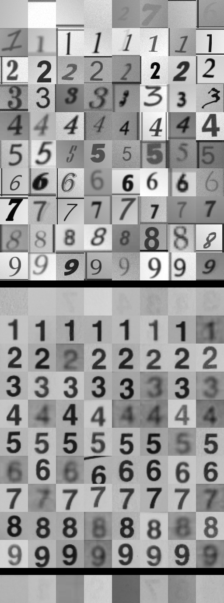
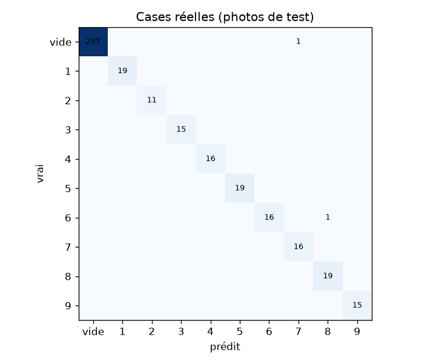
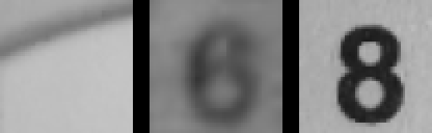
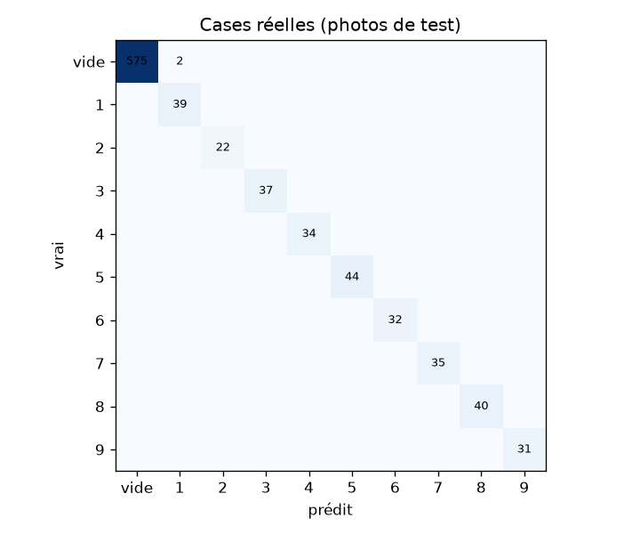
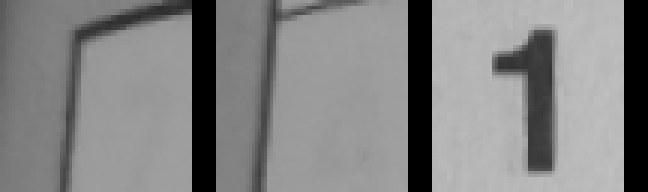

# 4. Lire les cases avec YOLO-cls

Code : `scripts/build_cells_dataset.py`, `scripts/train_cells.py`,
`src/sudoku_cv/digit_classifier.py`, `src/sudoku_cv/pipeline.py`.

Chaque case de 64×64 est classée parmi 10 classes : `0` pour vide, `1` à `9` pour les chiffres.
« Vide » est une vraie classe, pas une règle de seuil : le modèle apprend ainsi à ignorer lui-même
les chiffres fantômes du verso, les restes de traits et les taches.

Le modèle est `yolo11n-cls` (Ultralytics), pré-entraîné sur ImageNet, ~1,5 M de paramètres. C'est le
plus petit de la famille : il s'entraîne sur CPU en ~20 min et classe 81 cases en une fraction de
seconde.

## Le dataset

| Classe | Source | Train | Val |
|---|---|---|---|
| 1-9 | 882 polices Chars74K (repo rg1990, sans les 134 exclues), 2 rendus par image | 1 500 / classe | 264 / classe |
| 0 (vide) | cases vides synthétiques | 1 500 | 264 |
| 0 (vide) | vraies cases vides des photos d'entraînement | 1 019 | — |
| test (v1) | 405 vraies cases des photos 1, 4, 8, 19, 24, étiquetées à la main | | |

Les images Chars74K sont des chiffres noirs parfaits sur fond blanc, très loin d'une case
photographiée. Pour réduire cet écart de domaine, chaque rendu tire au hasard :

| Effet | Ce qu'il imite |
|---|---|
| fond gris 120-245 + dégradé linéaire | papier, éclairage inégal, ombre |
| encre 0-110 (toujours ≥ 50 niveaux sous le fond) | encre noire, imprimée grise, encre colorée |
| hauteur du chiffre 50-85 % de la case, décalage ±8 %, rotation ±6° | redressement imparfait |
| traits sur les bords (30 % par côté) | rognage imparfait de la grille |
| chiffre fantôme à 5-28 niveaux du fond (40 % des vides, 15 % des chiffres) | verso visible par transparence |
| réduction à 14-32 px puis agrandissement (40 %) | photo lointaine, écran |
| flou gaussien, bruit, compression JPEG | mise au point, capteur, compression |

En haut, le synthétique (classes 0 à 9) ; en bas, de vraies cases de test ; dernière ligne, de
vraies cases vides :

On a désactivé deux augmentations d'Ultralytics qui changent la classe de l'image : `fliplr`, car un
2 ou un 3 en miroir n'est plus un chiffre valide, et `erasing`, qui peut effacer le chiffre et donner
une image vide étiquetée « chiffre ».

## Suivi avec MLflow

Le stockage se fait dans `sqlite:///mlflow.db` (artefacts dans `mlruns/`), expérience
`digit_classification`. Le script ouvre le run, et le callback MLflow d'Ultralytics y écrit les
hyperparamètres, la loss et la précision à chaque époque, les poids et les graphiques. On y ajoute
l'évaluation sur les vraies cases : métriques `real_*`, matrice de confusion `real_confusion.png`,
liste des erreurs `real_errors.txt`. Pour les consulter :
`.venv/Scripts/mlflow ui --backend-store-uri sqlite:///mlflow.db`.

## Premier run : `cells_v1`

15 époques, batch 128, 64×64, CPU (≈ 75 s par époque, 19 min au total).

| Mesure | Valeur |
|---|---|
| Précision validation (synthétique, polices inconnues) | 99,28 % |
| Précision sur les vraies cases (405) | 99,51 % (2 erreurs) |
| … sur les chiffres (147) | 99,32 % |
| … sur les vides (258) | 99,61 % |
| Grilles lues sans aucune erreur | 3 / 5 |

Les deux erreurs ont des causes précises :

*Gauche : photo 4, case (0,0). Milieu : photo 24, case (8,2). Droite : un 8 normal, pour comparer.*

Sur la photo 4, une case vide est lue comme un 7. Elle contient un trait diagonal, le bord courbé de
la grille mal corrigé dans le coin, et une barre oblique ressemble au jambage d'un 7. Le dataset ne
contenait que des traits horizontaux ou verticaux.

Sur la photo 24, un 6 est lu comme un 8. Il est rouge, sur écran, très flou, et sa boucle du haut est
presque fermée. Le modèle n'avait vu aucun vrai chiffre d'écran à l'entraînement, seulement des vides
réels.

Et 99,5 % par case ne suffit pas : une grille a 81 cases, donc la probabilité de la lire sans erreur
est 0,995⁸¹ ≈ 67 %, ce qui colle avec les 3 grilles parfaites sur 5. Pour 90 % de grilles parfaites,
il faudrait ~99,9 % par case. D'où deux chantiers : améliorer le modèle, et corriger les erreurs avec
les règles du sudoku (voir [doc 6](06_pipeline_evaluation.md)).

Ce score était aussi mesuré sur 405 cases seulement, où une erreur vaut 0,25 point, et il était biaisé
par une fuite de données ([doc 2](02_donnees.md)) : 6 photos d'entraînement montraient les mêmes
grilles que le test.

## v1_clean et v2, sur un test corrigé

Le nouveau test compte 11 photos et 891 cases, découpées par grille. On réentraîne d'abord la recette
v1 à l'identique (`cells_v1_clean`), puis on ajoute les améliorations pour la v2, afin de pouvoir
comparer les deux.

| Run | Recette | Val (synth., meilleure époque) | Cases réelles | Chiffres | Vides | Erreurs | Grilles parfaites |
|---|---|---|---|---|---|---|---|
| `cells_v1` *(fuite, pour info)* | polices + synthétique + vides réels | 99,28 % | 99,55 % | 99,68 % | 99,48 % | 4 | 8 / 11 |
| `cells_v1_clean` | idem, découpage par grille | 99,24 % | 99,66 % | 99,68 % | 99,65 % | 3 | 8 / 11 |
| `cells_v2` | + vraies cases chiffres (×3) + traits obliques dans les vides | 99,09 % | 99,78 % | 100 % | 99,65 % | 2 | 10 / 11 |

Les vraies cases chiffres de la v2 sont les 520 cases remplies des photos d'entraînement, dont les
chiffres rouges des photos 23 et 25, pré-étiquetées par `cells_v1` puis vérifiées. Les deux erreurs
visées ont disparu, et tous les vrais chiffres du test sont bien lus.

La validation baisse un peu (99,24 → 99,09 %) alors que le test réel monte. La validation est
synthétique, et ajouter de vraies cases rapproche le modèle des photos, pas des images synthétiques.
On a donc jugé sur le réel.

Il faut rester prudent sur l'écart : sur 891 cases, une erreur vaut 0,11 point, et les runs ne
diffèrent que de 1 ou 2 erreurs. La v2 paraît meilleure parce que chaque erreur corrigée l'est pour la
raison visée, mais il faudrait un test plus grand pour chiffrer le gain.

## Les 2 erreurs restantes de la v2

*Photo 18, cases (0,0) et (1,0), lues « 1 ». À droite, un vrai 1.*

Ces cases contiennent le bord extérieur de la grille : la page est courbée, le coin haut-gauche est
mal aligné et la colonne de gauche est décalée. Un trait vertical au milieu d'une case ressemble
vraiment à un 1, et le problème vient du redressement plutôt que du classifieur. Comme deux « 1 » dans
la même colonne font un doublon, la réparation par les règles peut les corriger.

Modèle retenu : `cells_v2` (`runs/cells/cells_v2/weights/best.pt`).
