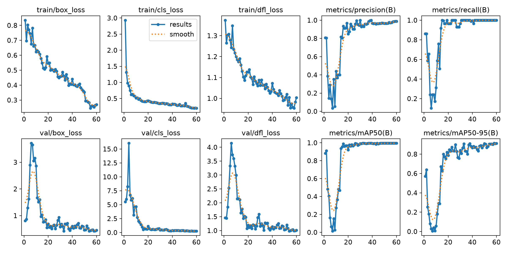

# Étape 5 — Détecter la grille : YOLO detect

Fichiers : `scripts/build_grid_dataset.py` (dataset) — entraînement : à venir

## Pourquoi un détecteur, alors qu'OpenCV trouve déjà la grille ?

`find_grid_corners` cherche « le plus grand quadrilatère de l'image ». Ça marche sur nos 25
photos, mais ça casse dès qu'un autre rectangle est plus grand : page entière, autre grille
(page voisine, solutions du jour précédent), tableau, écran… Un détecteur appris reconnaît
**une grille de sudoku** (9×9 cases, chiffres), pas juste un rectangle. On combine ensuite :
YOLO donne la zone, OpenCV y cherche les coins précis (voir étape 3).

## Dataset

### Sources

| Source | Images | Annotation |
|---|---|---|
| [wichtounet/sudoku_dataset](https://github.com/wichtounet/sudoku_dataset) (CC-BY-4.0) | 202 | 4 coins annotés par l'auteur (`outlines_sorted.csv`) |
| rg1990 | 24 (sans la 17) | **automatique** : intersections extrêmes trouvées par `dewarp_grid`, **vérifiées à l'œil** |

Recherche de datasets : voir `journal.md` (Roboflow Universe, Hugging Face, AICrowd comparés).

### Format

- **1 classe** : `0 = sudoku`.
- bbox = rectangle englobant des 4 coins ; format YOLO `classe cx cy w h` normalisé.
- images réduites à **1280 px** de côté max (les photos rg1990 font 12 Mpx : les décoder à
  chaque époque ralentirait beaucoup l'entraînement CPU ; YOLO travaille de toute façon en 640).
- les 4 coins sont gardés dans `data/grid_det/corners.json` → permet de tester plus tard une
  variante **YOLO-pose** qui prédit directement les 4 coins (piste de recherche).

### Découpage — attention aux doublons de grilles

| Ensemble | Images | dont wichtounet | dont rg1990 | Grilles distinctes |
|---|---|---|---|---|
| train | 156 | 143 | 13 | 43 |
| val | 29 | 29 | 0 | 21 |
| test | 41 | 30 | 11 | 27 |

Deux pièges trouvés et corrigés :

1. **Photos multiples de la même grille dans wichtounet** : 203 photos, seulement
   **77 grilles distinctes** (jusqu'à 18 photos de la même page). Le découpage officiel de
   l'auteur met 15 grilles à la fois en train et en test. → regroupement par grille (les
   chiffres du `.dat` servent d'identifiant), répartition ~70/15/15 du nombre de photos.
2. **Grilles communes aux deux datasets** : les photos rg1990 **24 et 25** montrent des grilles
   présentes aussi dans wichtounet (7 photos). Avec un découpage séparé par dataset, la grille
   de la photo de test 24 se retrouvait en validation via wichtounet. → découpage **global** :
   une grille déjà placée par le découpage rg1990 (étape 4) impose son ensemble à toutes ses
   photos. Contrôle automatique en fin de script : **0 grille dans plusieurs ensembles**.

Les photos de test rg1990 sont les mêmes que pour le classifieur de chiffres : on garde ainsi
un jeu de test **de bout en bout** (photo → solution) jamais vu par aucun des deux modèles.

### Vérification des annotations

Planches de contrôle `data/debug/grid_det_check_*.jpg` (bbox en vert, coins en rouge) :
les 226 annotations ont été regardées. Les 24 annotations automatiques rg1990 sont toutes
correctes (la photo 17, dont le coin est faux, est exclue).

### Observations sur les données (problèmes à anticiper)

- **Cadrage serré** : beaucoup de photos wichtounet sont cadrées sur la grille (bbox ≈ toute
  l'image). Le modèle risque d'apprendre « la grille = toute l'image ». Atténuation : les
  photos rg1990 (scènes larges) et l'augmentation **mosaic** d'Ultralytics (4 images
  assemblées → grilles plus petites, à des positions variées).
- **Grilles tournées de 90°** (wichtounet image1024, 1031-1041) : sans effet sur la détection
  (une bbox n'a pas d'orientation), mais **la lecture des chiffres devra gérer la rotation**
  (piste : essayer les 4 rotations et garder celle où le classifieur est le plus confiant /
  où la grille est valide).
- Beaucoup d'images en **640×480, floues**, chiffres **rouges**, papier journal jauni,
  cases **surlignées** (bandes bleues ou vertes).
- **Peu de grilles distinctes** (77 + 20) : le test (27 grilles) donne une mesure correcte
  pour la détection, mais il faudra des photos personnelles pour valider en conditions réelles.

## Résultats de `grid_v1` (yolo11n, 60 époques, CPU)

Run MLflow `grid_v1` (expérience `grid_detection`). L'entraînement a été interrompu à
l'époque 34, puis repris (voir `journal.md`). Durée totale ≈ 30 min sur CPU.

### Détection (mAP Ultralytics)

| Ensemble | Précision | Rappel | mAP50 | mAP50-95 |
|---|---|---|---|---|
| val (29 images) | 0,985 | 1,00 | 0,995 | 0,913 |
| **test (41 images)** | **0,997** | **1,00** | **0,995** | **0,921** |

La grille est trouvée sur **toutes** les images de test. Le mAP50-95, plus exigeant sur
l'ajustement du cadre, progresse peu après l'époque 38 (0,910) : 60 époques suffisent.

### Ce qui compte vraiment : les 4 coins

Une image est réussie si ses 4 coins sont à moins de 3 % du côté de la grille.

| Méthode | Réussite | Erreur médiane | wichtounet (30) | rg1990 (11) |
|---|---|---|---|---|
| A. OpenCV seul (référence) | 90,2 % | 1,18 % | 90,0 % | 90,9 % |
| **B. YOLO + OpenCV** | **95,1 %** | **1,12 %** | **96,7 %** | 90,9 % |
| C. YOLO seul (coins de la bbox) | 9,8 % | 4,80 % | 13,3 % | 0 % |

**Interprétation :**
- **B est la meilleure méthode** : YOLO isole la grille, ce qui règle 2 des 4 échecs
  d'OpenCV seul : la grille collée à la grille des solutions (w_image1077) et la page à
  l'envers (w_image1083). En restreignant la recherche de contour à la bbox, la grille voisine
  ne peut plus être fusionnée.
- **C ne suffit pas** : une bbox est un rectangle droit, alors que la grille photographiée est
  un quadrilatère quelconque (perspective). C'est pourquoi on garde OpenCV pour les coins ;
  la bbox seule ne sert que de dernier repli.
- **2 échecs restants pour B :**
  - `rg_18` (4,9 %) : page **courbée**. Les bords ne sont pas droits, donc aucun quadrilatère
    ne colle parfaitement. Le redressement par suivi des traits (`dewarp_grid`) doit compenser.
  - `w_image17` (4,0 %) : grille **coupée par le bord de la photo**. OpenCV seul ne trouvait
    rien (aucun contour fermé) ; avec YOLO on obtient des coins approximatifs, juste au-dessus
    du seuil. Une photo où la grille sort du cadre ne peut de toute façon pas être lue en entier.

**Conclusion :** objectif atteint pour la détection (mAP50 > 0,95). Le pipeline utilisera
YOLO → OpenCV dans la bbox → repli sur les coins de la bbox.
