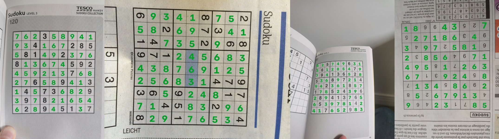

# 6. Pipeline complet et évaluation de bout en bout

## Ce qui a été fait

`src/sudoku_cv/pipeline.py` enchaîne toutes les briques :

```
photo ─► YOLO detect (bbox) ─► coins OpenCV dans la bbox ─► redressement fin (dewarp)
      ─► 81 cases ─► YOLO-cls ×4 orientations ─► meilleure orientation
      ─► réparation par les règles du sudoku ─► solveur ─► chiffres écrits sur la photo
```

- `SudokuPipeline(grid_weights, digit_weights).run(image)` renvoie un `PipelineResult` :
  statut (`solved`, `unsolvable`, `no_grid`), bbox, rotation, lecture brute, lecture réparée,
  confiance par case, solution, temps de chaque étape.
- `render_solution(image, result)` écrit les chiffres manquants sur la photo.
- `scripts/evaluate.py` mesure le tout sur le jeu de test, expérience MLflow `pipeline_eval`.

## Deux garde-fous ajoutés

### 1. Choix de l'orientation

**Problème observé :** certaines photos wichtounet montrent la grille tournée de 90° ou à
l'envers (journal photographié de côté). Les coins sont ordonnés par leur position dans la
photo, donc la grille redressée garde cette rotation : le classifieur lit des chiffres couchés
et se trompe sur environ 30 cases (w_image1041, 1043, 1083).

**Solution :** on classe les 81 cases dans les 4 orientations (rotations de 0°, 90°, 180° et
270° de la grille redressée) et on garde celle dont la **confiance moyenne sur les cases
lues comme chiffres** est la plus haute. Une grille à l'envers donne des 2, 3, 4, 5, 7
méconnaissables, donc une confiance basse. Les cases vides ne sont pas comptées : elles sont
sûres dans toutes les orientations et masqueraient la différence.

Coût : 4 × 81 petites images 64×64, soit environ +45 ms par photo.

### 2. Réparation par les règles du sudoku

**Idée :** une vraie grille de journal a **exactement une solution**. Si la lecture brute est
invalide (doublon) ou n'a pas une solution unique, au moins une case est mal lue.

**Méthode (`repair_grid`) :**
1. on prend les 8 cases les moins sûres ;
2. on essaie de remplacer 1 ou 2 d'entre elles par leur 2ᵉ ou 3ᵉ choix du classifieur ;
3. les combinaisons sont testées de la plus probable à la moins probable (coût = perte de
   log-vraisemblance) ; la première qui donne une grille à solution unique est retenue.

C'est la même idée qu'un correcteur orthographique : parmi les corrections qui donnent un
« mot » valide, on choisit la plus vraisemblable.

**Risque :** « réparer » vers une mauvaise grille qui a, par hasard, une solution unique.
On le surveille avec la métrique `wrong_solution_rate` (solution affichée mais fausse) : une
réponse fausse donnée avec assurance est pire qu'un « je n'y arrive pas ».

Tests unitaires : `tests/test_pipeline.py` (grille correcte inchangée, une erreur réparée,
deux erreurs réparées, abandon si les erreurs sont lues avec assurance).

## Résultats (41 photos de test, jamais vues par les deux modèles)

Le jeu de test est celui du détecteur : 30 photos wichtounet + 11 photos rg1990. Le
classifieur n'a été entraîné que sur des polices et des photos rg1990 d'entraînement, donc
aucune de ces photos n'a été vue par l'un ou l'autre modèle.

On ajoute les briques une à une (ablation) pour mesurer l'apport de chacune :

| Configuration | Grille trouvée | Cases justes | Grilles lues parfaitement | **Sudokus résolus** | Solutions fausses | Temps |
|---|---|---|---|---|---|---|
| OpenCV seul, lecture brute | 97,6 % | 94,9 % | 85,4 % | 85,4 % | 0 % | 0,19 s |
| + détecteur YOLO | 100 % | 96,9 % | 85,4 % | 85,4 % | 0 % | 0,12 s |
| + choix de l'orientation | 100 % | 99,4 % | 92,7 % | 92,7 % | 0 % | 0,17 s |
| **+ réparation (pipeline complet)** | **100 %** | 99,4 % | 92,7 % | **97,6 %** | **0 %** | 0,16 s |

Par source, pipeline complet : wichtounet 96,7 % (29/30), rg1990 **100 %** (11/11).

**Objectif du projet (≥ 90 % des sudokus résolus) atteint : 40 photos sur 41.**



*De gauche à droite : rg_1 (cas normal), w_image1041 (grille tournée de 90°), rg_18 (page
courbée, une case réparée), w_image1083 (page à l'envers). En vert les chiffres trouvés.*

### Ce que chaque brique apporte

- **YOLO** ne change pas le nombre de sudokus résolus ici, mais il trouve la grille sur
  100 % des photos (contre 97,6 %) et améliore les cases justes (94,9 % → 96,9 %), parce que
  les coins sont meilleurs (95,1 % contre 90,2 %, voir doc 5). Il est aussi plus rapide :
  OpenCV cherche dans une zone plus petite.
- **L'orientation** règle les 3 grilles tournées (w_image1041, 1043, 1083).
- **La réparation** règle 2 photos à une seule case fausse :
  - `rg_18` : case vide lue « 1 » (le bord de la grille, sur la page courbée, entre dans la
    case) ;
  - `w_image46` : un 1 lu « 4 ».
  Aucune réparation n'a produit de mauvaise solution.

### Échec restant

`w_image17` : la grille est **coupée par le bord de la photo**. Le détecteur la trouve, mais
une partie des cases est hors de l'image : 17 cases fausses, la plupart des chiffres lus
comme « vide ». La réparation abandonne (trop d'erreurs) et le pipeline répond
« insoluble » au lieu de donner une solution fausse : c'est le comportement voulu.

## Limites et suite

- 41 photos de test et 27 grilles distinctes : chaque photo pèse 2,4 points de pourcentage.
  Il faudra valider sur des **photos personnelles** prises au téléphone (application
  Streamlit, étape suivante).
- Les chiffres de la solution sont écrits droits par rapport à la photo, même quand la
  grille est tournée : c'est plus lisible, mais pas dans le sens de la grille.
- Une erreur de lecture qui donne quand même une grille à solution unique ne peut pas être
  détectée. Aucune sur ce test, mais c'est possible en théorie.

## Commandes

```bash
.venv/Scripts/python scripts/evaluate.py              # les 4 configurations
.venv/Scripts/python scripts/evaluate.py --configs full --renders   # + photos annotées dans runs/eval/
```
