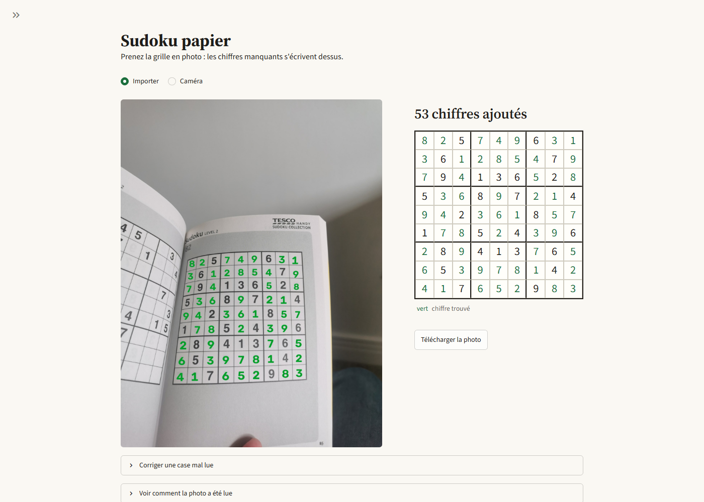
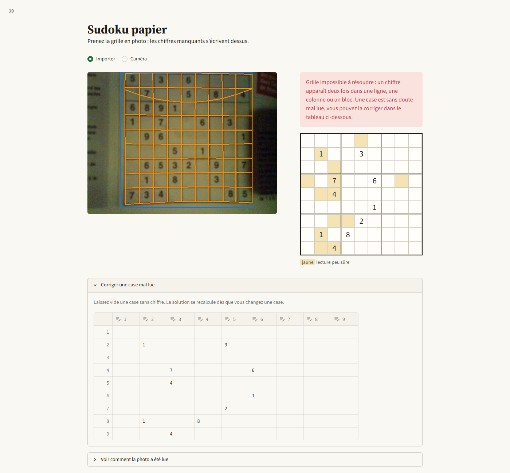

# 7. L'application Streamlit

Code : `app/streamlit_app.py`, thème dans `.streamlit/config.toml`.

```bash
.venv/Scripts/streamlit run app/streamlit_app.py      # http://localhost:8501
```



## Le parcours

On importe une photo ou on en prend une avec la caméra. Le résultat s'affiche tout de suite : la photo
avec les chiffres écrits dessus, et à côté la grille dessinée, avec les chiffres trouvés en vert. Les
cases peu sûres (confiance < 0,8) sont en jaune, les cases corrigées par les règles du sudoku en
orange. On peut télécharger la photo résolue.

Le reste est replié, pour ne pas noyer quelqu'un qui veut juste sa solution :

- **Corriger une case mal lue** : un tableau modifiable, où une case vide reste vide. La solution se
  recalcule sans relancer les modèles. Cette section s'ouvre toute seule si la grille n'a pas pu être
  résolue.
- **Voir comment la photo a été lue** : le cadre YOLO en bleu, les 20 traits suivis en orange, la grille
  redressée et le temps de chaque étape. C'est ce qui sert en démo, et pour comprendre un échec.

Quand la grille est impossible à résoudre, on le dit et on explique pourquoi, sans afficher de solution :



La barre latérale, repliée par défaut, permet de choisir les modèles (Model Registry avec l'alias
`champion`, ou fichiers locaux) et de couper le test des orientations ou la réparation, pour montrer en
démo ce que chacun apporte.

## Le mode démo

Le sélecteur de source propose `Demo` à côté de `Upload` et `Camera`. L'application fabrique un lot de photos
synthétiques dont on connaît la bonne réponse (code : `src/sudoku_cv/generator.py`, `synth.py`, `demo_batch.py`,
interface dans `app/demo.py`). Une graine fixe le lot, et trois tailles donnent 18, 36 ou 54 photos.

Chaque passage couvre : grilles propres, de travers, couchées à 90° ou à l'envers, dans l'ombre, plusieurs
grilles sur la page, **grilles invalides** (doublon visible, sans solution, plusieurs solutions), page sans grille,
et trois **cas limites** (flou fort, sombre et bruité, grille coupée).

« Run the whole batch » lit tout le lot et classe chaque photo : correct, limite atteinte (cas limite non résolu),
raté, ou **réponse fausse** (solution qui n'est pas la grille de la photo, ou grille invalide « résolue » sans correction). Un clic
sur « Open » ouvre la photo dans une fenêtre modale, avec le parcours habituel (résolution, pas à pas, correction)
et un bandeau qui rappelle ce qu'elle doit montrer. On la ferme pour revenir au lot, résultats compris.
Le lot se télécharge en zip, avec un `manifest.csv` de la réponse attendue.

Sur une grille invalide (doublon, ou plusieurs solutions), l'application a deux bonnes réponses : refuser, ou
corriger les cases en cause puis résoudre. La démo compte les deux comme justes ; une grille invalide résolue
sans correction serait en revanche une réponse fausse.

## Choix techniques

`st.cache_resource` charge les modèles YOLO une seule fois. Le résultat du pipeline est gardé dans
`st.session_state`, avec comme clé l'empreinte MD5 de la photo et les réglages : modifier une case
relance seulement le solveur (quelques ms), pas la détection ni la lecture (environ 0,8 s).

On laisse la main à l'utilisateur plutôt que d'échouer sèchement : sur une photo difficile (grille
coupée, w_image17), les cases douteuses sont signalées et on peut finir la lecture à la main.

La correction est placée sous le résultat, alors qu'elle décide de ce qu'il affiche. Le résultat est
donc dessiné dans un `st.container()` réservé en haut, rempli une fois le tableau lu.

## Problèmes rencontrés

- `cv2.polylines` refusait les colonnes du tableau des intersections (`pts[:, k]`) : une colonne numpy
  n'est pas contiguë en mémoire et OpenCV exige un tableau contigu. Corrigé avec `np.ascontiguousarray`.
- `use_container_width` est obsolète dans Streamlit 1.66, remplacé par `width="stretch"`.
- Une colonne numérique du tableau affiche « None » dans chaque case vide. On est passé à des colonnes
  texte, limitées à un chiffre de 1 à 9 par une expression régulière.
- Dans la grille dessinée, les lignes sans aucun chiffre s'écrasaient, et la grille devenait illisible
  sur les photos ratées. La hauteur des 9 lignes est maintenant imposée (`grid-template-rows`).
- `streamlit.testing.AppTest` ne sait pas simuler l'import d'un fichier. On remplace `st.file_uploader`
  par une fonction qui renvoie une photo de test, pour vérifier quatre cas : aucune photo, page courbée
  réparée (rg_18), grille coupée insoluble (w_image17), grille tournée de 90° résolue (w_image1041).
  `AppTest` ne montre pas le rendu, alors on regarde aussi l'application dans un vrai navigateur.
